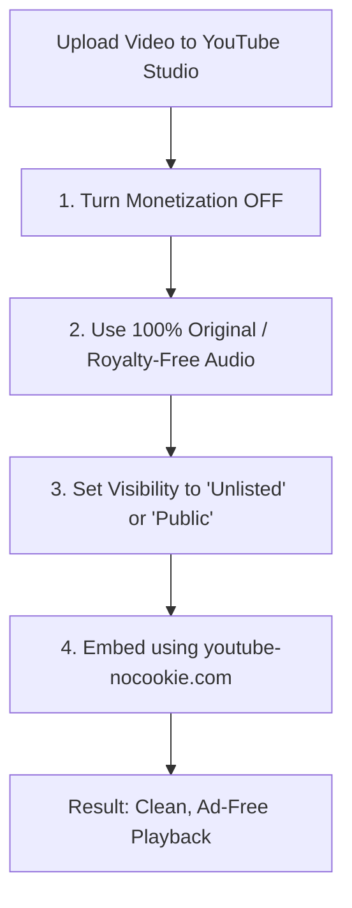

# NORVI — Customer Agent Guide & Universal YouTube Integration Specification

## 1. Executive Summary & Understanding

Based on your current platform architecture (Astro + React client UI, Cloudflare/Netlify API, and Supabase data layer) and the screenshot of your customer portal at `/account/agents/`, here is the exact understanding of your goals:

1. **Customer "Guide" Button (`/account/agents`):**
   - Add a dedicated **Guide** button alongside the existing `[ View license ]` and `[ Download ]` buttons for each owned agent.
   - When a customer who purchased an agent clicks this button, it opens a dedicated single-page guide view (or full-screen modal) with everything they need to successfully set up, run, and master that specific agent.

2. **Admin Panel Guide Builder (Modeled after the FAQ Builder):**
   - You want a dynamic builder in your Admin Panel's Agent Editor, structured just like your existing **FAQs Builder**:
     - An **`+ Add Guide Section`** button.
     - Each section has a **Heading** (e.g., *"Step 1: Unzip and Install"*).
     - A **Content / Answer** textarea for detailed step-by-step instructions.
     - An **Optional Image** uploader or URL input. If you upload or link an image, it renders cleanly in that section; if left empty, the section renders text-only.
     - A **Delete** button to remove sections, and reordering capability.
     - A top field to set a **Full Walkthrough Video** (supporting YouTube URLs or direct video links).

3. **Switching from Database Video Uploads to YouTube:**
   - Instead of storing 20MB–50MB video files in your database/storage (which consumes egress bandwidth and can buffer for users), you want the ability to upload videos to YouTube and link them directly.
   - This YouTube integration should power:
     1. **The New Customer Guide Video**
     2. **The Public Agent Page Hero Section Video**
     3. **The Public Agent Page Walkthrough Section Video**
   - In the admin panel, you will have simple fields to add or change any YouTube URL at any time.

4. **Eliminating / Minimizing Ads on YouTube Embeds:**
   - You need clear technical rules on how to ensure embedded videos play cleanly without intrusive ads.

---

## 2. YouTube Ads: Complete Facts & Best Practices

Can we guarantee that embedded YouTube videos never show ads?

### How YouTube Ad Serving Works
YouTube embeds run in an isolated iframe governed by Google. There is no custom HTML/CSS code that can force YouTube to strip ads. However, you can achieve an **essentially 100% ad-free experience** by following these four steps:



### The 4 Rules for Zero-Ad YouTube Embeds
1. **Turn Monetization OFF in YouTube Studio:**
   - Open [YouTube Studio](https://studio.youtube.com/) $\rightarrow$ Click **Content** $\rightarrow$ Select your video $\rightarrow$ Under **Monetization**, set it to **Off**.
   - With monetization disabled, YouTube will not schedule pre-roll, mid-roll, or post-roll partner ads.
2. **Never Use Copyright-Claimed Background Music:**
   - If a third party files a Content ID claim on your audio, YouTube's policy allows that third party to monetize the video with ads, even if your channel has monetization turned off. Keep audio to your voiceover and royalty-free / licensed music.
3. **Use the Privacy-Enhanced Domain (`youtube-nocookie.com`):**
   - Standard YouTube embeds use `youtube.com/embed/...`, which tracks cookies and triggers targeted ad auctions.
   - By using `https://www.youtube-nocookie.com/embed/{VIDEO_ID}?rel=0&modestbranding=1`, YouTube strips personalization cookies, which minimizes ad serving and enhances user privacy.
4. **"Unlisted" Visibility:**
   - Setting your tutorial videos to "Unlisted" prevents them from competing in public algorithmic ad queues while allowing anyone on your site (or with the link) to watch them.

> [!TIP]
> **Zero-Ad Guarantee Alternative (Bunny.net Stream):**
> If you ever have a video that absolutely cannot use YouTube, you can use **Bunny Stream** or **Cloudflare Stream**. They cost roughly \$1/month, provide 100% zero ads, customized branding, and custom video speeds. Our player architecture will support both seamlessly!

---

## 3. UI/UX Architecture

### A. Customer Portal: "My Agents" (`/account/agents`)

```
+-----------------------------------------------------------------------------------------------+
|  NORVI / My account                                           Back to website ↗   (C) chirag  |
|                                                                                               |
|  YOUR PERSONAL WORKSPACE                                                                      |
|  Your agent collection.                                                                       |
|                                                                                               |
|  +-----------------------------------------------------------------------------------------+  |
|  | [Icon] Voro                                                                    [active] |  |
|  |        Added 27 Sept 2026                                                               |  |
|  |                                                                                         |  |
|  |   [ View license 🔑 ]       [ Guide 📖 ]                     [ Download ⬇️ ]             |  |
|  +-----------------------------------------------------------------------------------------+  |
|                                                                                               |
+-----------------------------------------------------------------------------------------------+
```

When the customer clicks **`[ Guide 📖 ]`**:
- A dedicated, high-impact **Agent Guide Modal / View** opens.
- Features inside the Guide View:
  1. **Header:** Agent Logo, Name, Version, and a **"Copy Your License Key"** quick chip (`NORVI-XXXX-...` [Copy]) so users don't need to leave the guide to find their key.
  2. **Hero Video Tutorial:** Responsive video player playing the YouTube guide. Below it: a subtle link `Watch on YouTube ↗`.
  3. **Step-by-Step Sections (Chronological):**
     - Step 01: Heading & detailed explanation.
     - Optional high-res screenshot (with click-to-enlarge lightbox).
     - Step 02: Heading, instructions, optional copyable command or config snippet.
     - Step 03: Verification & testing.
  4. **Need Help? Banner:** Direct link to open a priority support ticket for that specific agent.

---

### B. Admin Panel: "Customer Guide" Builder (`/admin/products`)

In the Agent Editor Modal, add a new tab: **"Setup Guide"** (alongside Overview, Media, Pillars, Comparison, FAQs, SEO).

```
[ Identity & Copy ] [ Media & Gallery ] [ Feature Pillars ] [ FAQs Builder ] [ ★ Setup Guide ] [ SEO ]
------------------------------------------------------------------------------------------------------
Walkthrough Video:
[ https://www.youtube.com/watch?v=dQw4w9WgXcQ                                            ]
Preview: [ YouTube Video Embedded Player ]

Guide Sections:
+----------------------------------------------------------------------------------------------------+
| Section 1                                                                       [ 🗑 Delete ]      |
| Heading: [ Step 1: Install & Extract the Voro Package                                           ]  |
| Content: [ Download the .zip archive to your Windows desktop. Right-click and Extract All...    ]  |
| Optional Screenshot:                                                                               |
| [ Upload Image File ] or [ Paste Image URL: https://...                                         ]  |
| Image Preview: [ Thumbnail of screenshot ]                                                         |
+----------------------------------------------------------------------------------------------------+

[ + Add Guide Section ]

[ Save Changes ]
```

---

## 4. Universal Video Player Architecture

We create a reusable React component: `<SmartVideoPlayer url={url} title={title} />`.

### Supported URL Formats:
- Standard YouTube: `https://www.youtube.com/watch?v=abc123XYZ`
- Short YouTube: `https://youtu.be/abc123XYZ`
- Embed YouTube: `https://www.youtube.com/embed/abc123XYZ`
- Direct Video: `https://.../video.mp4` or `https://.../video.webm`

### Embedding Logic:
- If the URL matches a YouTube pattern:
  - Extract the 11-character video ID.
  - Render:
    ```html
    <iframe
      src="https://www.youtube-nocookie.com/embed/{id}?rel=0&modestbranding=1&playsinline=1"
      title="{title}"
      allow="accelerometer; autoplay; clipboard-write; encrypted-media; gyroscope; picture-in-picture"
      allowFullScreen
      style="width: 100%; aspect-ratio: 16/9; border: 0; border-radius: 8px;"
    ></iframe>
    ```
  - Include an optional small button: `Open on YouTube ↗`.
- If the URL ends with `.mp4`, `.webm`, or is a direct storage URL:
  - Render `<video src={url} controls playsInline preload="metadata" />`.

---

## 5. Data Model Updates (`packages/shared/model.ts`)

```typescript
export type GuideSection = {
  id: string;
  heading: string;
  content: string;
  imageUrl?: string | null;
  codeSnippet?: string | null;
};

export type AgentGuide = {
  videoUrl?: string | null;
  summary?: string | null;
  sections: GuideSection[];
};

export type AgentExtendedContent = {
  // Existing fields:
  badgeText?: string;
  heroMediaUrl?: string | null;
  heroMediaType?: 'video' | 'gif' | 'image';
  platformBadges?: string[];
  featurePillars?: FeaturePillar[];
  gallery?: MediaGalleryItem[];
  comparison?: CompetitorComparison;
  workflowSteps?: WorkflowStep[];
  faqs?: AgentFaq[];
  seo?: AgentSeo;

  // New Guide & Video fields:
  heroYoutubeUrl?: string | null;
  workflowYoutubeUrl?: string | null;
  guide?: AgentGuide;
};
```

---

## 6. Detailed Implementation Steps

| Step | File / Component | What Changes |
| :--- | :--- | :--- |
| **1** | [`packages/shared/model.ts`](file:///e:/Agency/packages/shared/model.ts) | Add `GuideSection`, `AgentGuide`, and add `guide` to `AgentExtendedContent`. |
| **2** | [`apps/web/src/ui/common.tsx`](file:///e:/Agency/apps/web/src/ui/common.tsx) | Create `<SmartVideoPlayer />` supporting YouTube ID extraction, `youtube-nocookie.com`, and fallback to HTML5 `<video>`. |
| **3** | [`apps/web/src/ui/Workspace.tsx`](file:///e:/Agency/apps/web/src/ui/Workspace.tsx) (Admin) | Add the **"Setup Guide"** tab in `ProductForm` with `videoUrl`, dynamic Guide Sections list (Heading, Content, Optional Image, Delete), and live YouTube preview. Update the **Media** tab to accept YouTube URLs for Hero & Walkthrough. |
| **4** | [`apps/web/src/ui/Workspace.tsx`](file:///e:/Agency/apps/web/src/ui/Workspace.tsx) (Customer) | In `section === '/agents'`, add the `[ Guide 📖 ]` button on each owned agent card. Create the `AgentGuideModal` component rendering the YouTube video, quick key copy, and formatted sections with images. |
| **5** | [`apps/web/src/ui/PublicPages.tsx`](file:///e:/Agency/apps/web/src/ui/PublicPages.tsx) | Update the Public Agent Hero section and Walkthrough section to use `<SmartVideoPlayer />` so any YouTube URL pasted in the admin panel displays seamlessly. |
| **6** | Seed & Persistence Check | Ensure `catalog.json` and Supabase product persistence preserves the guide structure and YouTube URLs when saving. |

---

## 7. Open Design Preferences for Your Confirmation

Before we write the code, please confirm your preferences on these three minor details:

1. **Guide Presentation on Customer Side:**
   - *Option A (Recommended):* A clean, wide modal pop-up on `/account/agents` (fast, no page reload, user stays right on their collection).
   - *Option B:* A dedicated page route (e.g. `/account/agents/voro/guide`).
2. **Button Label:**
   - Do you prefer the button text to say **"Guide"**, **"Setup guide"**, or **"Documentation"**?
3. **Hero & Walkthrough YouTube Links:**
   - Would you like the Admin Panel Media tab to have a simple text input: `"YouTube Video Link (or Direct Video File)"` where pasting a YouTube link automatically switches it over?
