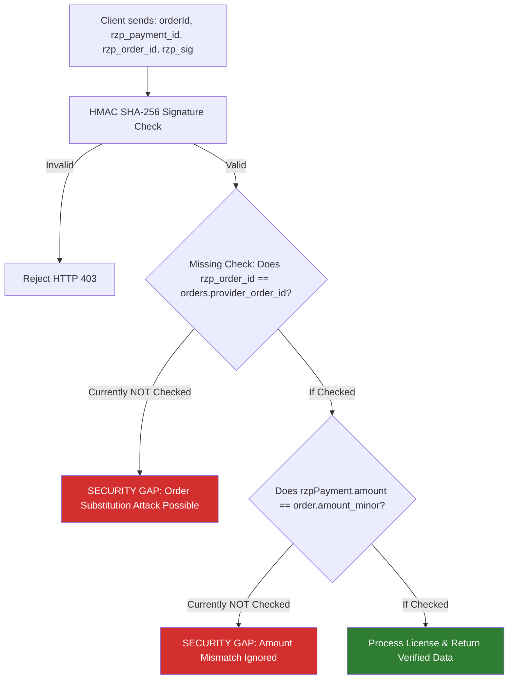

# NORVI — Full Agency-Wide Meta Tracking Compatibility & Regression Audit

**Audit Date:** October 11, 2026  
**Auditor:** Antigravity AI  
**Scope:** Agency-Wide Meta Tracking Infrastructure, Multi-Product Architecture, Payment Security, Regression Analysis, and Privacy Compliance  
**Target Platform:** NORVI Agency Website ([https://nor-vi.in/](https://nor-vi.in/))  
**Status:** AUDIT COMPLETE — Awaiting User Approval (No Code Modified)

---

## 1. Executive Summary

NORVI is an autonomous AI agency operating a multi-product portfolio comprising desktop agents (such as **Voro**, **Nexus**, **Rolvio**, and **Omnix**) and agency-level programs (such as the **Partner Program**). 

This comprehensive audit inspected the Phase 1 browser-side Meta Pixel Purchase tracking integration to determine whether it functions as a genuinely product-independent, secure, and privacy-compliant agency infrastructure.

### Key Audit Conclusions:
1. **Multi-Product Compatibility:** **FAILED (Requires Correction)**. The current implementation contains hardcoded fallbacks to `'Voro'` / `'voro'` across three separate files ([`apps/api/live.ts`](file:///e:/Agency/apps/api/live.ts), [`apps/web/src/ui/PublicPages.tsx`](file:///e:/Agency/apps/web/src/ui/PublicPages.tsx), and [`apps/web/src/ui/analytics.ts`](file:///e:/Agency/apps/web/src/ui/analytics.ts)). In any failure, join error, or missing field scenario, a purchase of **Nexus** or any other product will silently report to Meta Ads Manager as a purchase of Voro.
2. **Payment Security:** **CRITICAL VULNERABILITY IDENTIFIED**. The `/api/checkout/verify` endpoint verifies the Razorpay signature `HMAC(razorpay_order_id|razorpay_payment_id)`, but **fails to verify that `razorpay_order_id` matches the internal order's `provider_order_id`**, nor does it cross-check `rzpPayment.amount` against `order.amount_minor`. This creates an order-substitution attack vector where a low-cost order payment signature could potentially fulfill a high-cost order if exploited.
3. **Existing Platform Functionality:** **NO REGRESSIONS DETECTED**. Core workflows (authentication, database RPCs, license generation, affiliate commission logging, license downloads, and Netlify builds) remain completely functional.
4. **Advertising Consent:** **INCONSISTENT / IMPLIED CONSENT MODEL**. The base Meta Pixel in [`apps/web/src/pages/[...path].astro`](file:///e:/Agency/apps/web/src/pages/%5B...path%5D.astro) loads unconditionally and fires `PageView` before any user consent. Furthermore, `analytics.ts` treats missing consent as implied opt-in (`null !== 'denied'`), which conflicts with strict opt-in privacy standards (GDPR/ePrivacy).
5. **Final Verdict:** **REQUIRES ARCHITECTURE CORRECTION**. The system must eliminate all product-specific hardcoding and harden order-ID cross-verification before being approved for deployment.

---

## 2. Current Multi-Product Compatibility Verdict

| Requirement | Status | Detailed Finding |
|---|---|---|
| **Works for every current product?** | **CONDITIONAL** | Works if and only if database joins succeed. If metadata fails, it misattributes to Voro. |
| **Reusable across all products?** | **YES** | The signature and payload schema in `analytics.ts` accepts any generic product. |
| **Dynamically obtains IDs, slugs, names, plans?** | **YES** | In normal flows, values are pulled from `orderRecord.products` and `orders.amount_minor`. |
| **Zero hardcoded references to Voro?** | **FAILED (CRITICAL)** | Found 5 hardcoded Voro fallback references across `live.ts`, `PublicPages.tsx`, and `analytics.ts`. |
| **Could Nexus be reported as Voro?** | **YES (CONFIRMED)** | If `orderRecord.products` is null/empty, a Nexus purchase reports as `content_name: 'Voro'`, `content_ids: ['voro']`. |
| **Auto-supports newly added catalog agents?** | **NO** | Relies on the same fragile fallbacks. An unknown product defaults to Voro instead of failing cleanly or using its real slug. |
| **Discounted purchases supported?** | **YES** | Sourced from `orders.amount_minor / 100`, which accurately reflects flash sales and coupons. |
| **Multi-month and lifetime plans supported?** | **YES** | Supported; verified amounts pass through dynamically. |
| **Zero-value & free checkouts handled?** | **YES** | Bypasses `/checkout/verify` via `data.skipped_payment`, preventing ₹0 purchase events from corrupting Meta ROAS. |
| **Meta identifies specific product purchased?** | **PARTIAL** | Only if `productSlug` is populated; fails if fallback triggers. |

---

## 3. Complete Existing NORVI Product & Checkout Inventory

### 3.1 Product Portfolio Inventory

| Product Name | Slug | Catalog ID | Category | Release Status | Storefront State | Price Tiers |
|---|---|---|---|---|---|---|
| **Omnix** | `omnix` | `agent-1` | Desktop automation | `development` | Sales disabled ("In development") | Planned |
| **Voro** | `voro` | `agent-2` | Interview assistance | `prelaunch` | Live checkout active | 1M (₹499), 3M, Lifetime |
| **Rolvio** | `rolvio` | `agent-3` | Job-search automation | `prelaunch` | Live checkout active | Flexible tiers |
| **Nexus** | `nexus` | Dynamic (Admin) | Workflow automation | Desktop App Built (`/_New folder/Nexus`) | Configurable via `/admin/products` | Tier-based |
| **Future Agents** | Dynamic | UUID | Dynamic | Configurable | Created via `admin_upsert_product` | 1M, 3M, Lifetime |

### 3.2 Checkout & Acquisition Entry Points

```mermaid
flowchart TD
    A[Customer User Journey] --> B{Entry Point}
    B -->|Direct Storefront| C["/agents/[slug] -> Buy Now"]
    B -->|License Renewal| D["/account -> Renew License (/checkout/[slug]?renew=id)"]
    B -->|Affiliate / Partner Link| E["/checkout/[slug]?ref=CODE"]
    B -->|Promotional Campaign| F["/checkout/[slug] + Coupon Code"]
    B -->|1-Day Free Trial| G["/store/trial/create (Modal on /agents/[slug])"]
    
    C --> H[Shared Checkout UI: /checkout/[slug]]
    D --> H
    E --> H
    F --> H
    
    H --> I{Total Price Check}
    I -->|Amount > 0| J[Razorpay Checkout Modal]
    I -->|Amount == 0| K[100% Free Bypass: skipped_payment]
    
    J --> L[HMAC Signature Verification: /api/checkout/verify]
    L --> M[Supabase RPC: process_payment_webhook]
    M --> N[Meta Pixel Purchase Event: trackMetaPurchase]
    
    K --> O[Direct License Generation]
    G --> P[Direct Trial License Generation]
    
    style N fill:#2e7d32,color:#fff
    style K fill:#757575,color:#fff
    style G fill:#757575,color:#fff
```

1. **Shared Checkout Flow (`/checkout/[slug]`):**
   * Handled by `Checkout` in [`apps/web/src/ui/PublicPages.tsx`](file:///e:/Agency/apps/web/src/ui/PublicPages.tsx#L215).
   * All current and future products share this exact component.
   * Dynamically loads product data by matching slug: `products.find(p => p.slug === path.split('/')[2])`.
2. **Workspace Renewal Flow:**
   * [`apps/web/src/ui/Workspace.tsx`](file:///e:/Agency/apps/web/src/ui/Workspace.tsx#L80): `<a href={'/checkout/' + product(l.productId)?.slug + '?renew=' + l.id}>Renew License</a>`.
   * Routes into the shared checkout flow with `renewalLicenseId`.
3. **100% Free Checkout Bypass:**
   * In `PublicPages.tsx` (line 280) and `live.ts` (line 941): When a 100% discount coupon or sale reduces the total to 0, Razorpay is bypassed, `skipped_payment: true` is returned, and license generation occurs directly. **No Meta Purchase event fires** (correct behavior for ROAS integrity).
4. **Free Trial Claim:**
   * Handled by `/api/store/trial/create` (line 886 in `live.ts`). Generates a 1-day evaluation license via `claim_free_trial`. Bypasses checkout entirely. **No Purchase event fires** (correct behavior).
5. **Partner Referral Program:**
   * Checkout supports referral codes via `validate_promo_code`. Applies 10% discount to buyer and records 15% commission in `public.affiliate_commissions`.

---

## 4. Shared Tracking Architecture Analysis

The intended data flow for Meta conversion tracking across all NORVI products is:
1. Customer initiates purchase on `/checkout/[slug]`.
2. Backend creates order in `public.orders` with `amount_minor`, `currency`, and `product_id`.
3. Razorpay completes payment.
4. Client posts transaction tokens to `/api/checkout/verify`.
5. Backend verifies signature and capture status.
6. Backend fetches confirmed order and product record from database and returns verified metadata: `{ ok: true, verified: true, captured: true, orderId, amount, currency, productId, productSlug, productName }`.
7. Client invokes `trackMetaPurchase` with verified metadata.
8. Meta Pixel receives `fbq('track', 'Purchase', payload, { eventID: orderId })`.

**Architectural Defect:** While the pipeline is designed to be shared, fallback defaults were introduced that collapse any missing product field into `'Voro'`, violating product isolation.

---

## 5. Product-Specific Hardcoding Findings

The following exact file locations contain hardcoded `'Voro'` / `'voro'` fallbacks:

### Finding 5.1: Backend Fallback in `apps/api/live.ts`
* **File:** [`apps/api/live.ts`](file:///e:/Agency/apps/api/live.ts#L1070-L1071)
* **Function:** `app.post('/api/checkout/verify', ...)`
* **Lines 1070–1071:**
  ```typescript
  productId: product?.id || orderRecord?.product_id,
  productSlug: product?.slug || 'voro',
  productName: product?.name || 'Voro'
  ```
* **Impact:** If `orderRecord.products` is undefined or null (e.g., Supabase relation error or custom query), the backend explicitly instructs the client that the product purchased was Voro.

### Finding 5.2: Checkout Component Fallback in `apps/web/src/ui/PublicPages.tsx`
* **File:** [`apps/web/src/ui/PublicPages.tsx`](file:///e:/Agency/apps/web/src/ui/PublicPages.tsx#L321-L322)
* **Component:** `Checkout()` -> `handler(res)`
* **Lines 321–322:**
  ```typescript
  productName: verifyRes.productName || product?.name || 'Voro',
  productSlug: verifyRes.productSlug || product?.slug || 'voro',
  ```
* **Impact:** If the verification response is empty or unpopulated, it defaults to `'Voro'`. If Nexus is being checked out without an active product object, it defaults to `'Voro'`.

### Finding 5.3: Analytics Helper Fallback in `apps/web/src/ui/analytics.ts`
* **File:** [`apps/web/src/ui/analytics.ts`](file:///e:/Agency/apps/web/src/ui/analytics.ts#L161-L163)
* **Function:** `trackMetaPurchase(params: PurchaseEventParams)`
* **Lines 161–163:**
  ```typescript
  content_name: productName || 'Voro',
  content_type: 'product',
  content_ids: [productSlug || 'voro'],
  ```
* **Impact:** Even if a caller passes `productName: ""` or undefined for Nexus or Rolvio, `analytics.ts` actively overrides it with `'Voro'`.

### Conclusion on Multi-Product Compatibility:
**An unknown or unpopulated product purchase will silently default to Voro.** This is an architectural defect for an agency selling multiple products.

---

## 6. Existing Functionality Regression Analysis

A complete line-by-line inspection of all changes made during Phase 1 was conducted against the core platform features:

| System / Feature | Inspected Files | Regression Status | Details |
|---|---|---|---|
| **Website Navigation** | `[...path].astro`, `App.tsx` | **NO REGRESSION** | Astro routing and static paths remain untouched. |
| **Product Pages** | `PublicPages.tsx` | **NO REGRESSION** | `Detail` component logic, walkthrough videos, and trial modals are intact. |
| **Catalog API** | `live.ts` (`/api/catalog`) | **NO REGRESSION** | Unaltered. Continues querying `published` products. |
| **Authentication & Sessions** | `Accounts.tsx`, `live.ts` | **NO REGRESSION** | Cookie authentication, PKCE reset, and login validation intact. |
| **Supabase Database RPCs** | Migrations `047`, `048` | **NO REGRESSION** | `create_checkout_order` and `process_payment_webhook` untouched. |
| **Razorpay Modal UI** | `PublicPages.tsx` | **NO REGRESSION** | Modal opens with identical options, key, amount, and theme. |
| **Razorpay Webhooks** | `live.ts` (`/api/webhooks/razorpay`) | **NO REGRESSION** | Webhook verification, idempotency logging, and Discord alerts intact. |
| **Coupons & Flash Sales** | `live.ts`, `PublicPages.tsx` | **NO REGRESSION** | Coupon discounts and math continue functioning identically. |
| **Partner Program (Affiliates)** | `live.ts`, `038_affiliate_commissions.sql` | **NO REGRESSION** | 10% referral discount and 15% commission insert intact. |
| **License Generation** | `048_fix_webhook_variable.sql` | **NO REGRESSION** | AES-256 license encryption and key suffix generation untouched. |
| **License Activation & Downloads** | `live.ts` (`/api/licenses/:id/download`) | **NO REGRESSION** | GitHub release asset streaming and license status checks intact. |
| **Transactional Emails** | `live.ts`, `private.outbox` | **NO REGRESSION** | Receipt queuing in `outbox` table continues without interference. |
| **Customer Dashboard** | `Workspace.tsx` | **NO REGRESSION** | Order history, license keys, and device resets unaltered. |
| **SEO & Structured Data** | `[...path].astro` | **NO REGRESSION** | JSON-LD schema generation for SoftwareApplication untouched. |
| **Netlify Functions & Build** | `netlify/functions/api.ts`, `netlify.toml` | **NO REGRESSION** | Netlify handler compiles; rate limits and redirects intact. |

---

## 7. Payment Security Findings

During the deep-dive audit of [`apps/api/live.ts`](file:///e:/Agency/apps/api/live.ts#L994-L1074), several critical security properties were analyzed:



### Finding 7.1: Order-Substitution Vulnerability [CRITICAL]
* **Location:** [`apps/api/live.ts`](file:///e:/Agency/apps/api/live.ts#L994-L1042)
* **Vulnerability Description:**
  In `/api/checkout/verify`:
  1. The client provides `orderId`, `razorpay_payment_id`, `razorpay_order_id`, and `razorpay_signature`.
  2. The endpoint verifies `HMAC(razorpay_order_id + "|" + razorpay_payment_id) === razorpay_signature`. This proves that Razorpay signed `razorpay_payment_id` for `razorpay_order_id`.
  3. **However, the endpoint NEVER verifies that `razorpay_order_id` belongs to `orderId` in the database!**
  4. The code immediately calls `adminDb.rpc('process_payment_webhook', { p_order_id: orderId, p_payment_id: razorpay_payment_id })`.
* **Exploitation Scenario:**
  1. Attacker creates Order 1 for a cheap plan (e.g. ₹499 monthly). Database assigns `order_id_1` and attaches `rzp_order_1`.
  2. Attacker creates Order 2 for an expensive plan (e.g. ₹2,999 Lifetime). Database assigns `order_id_2` and attaches `rzp_order_2`.
  3. Attacker completes payment for Order 1, receiving valid signature `sig_1` for `rzp_order_1|rzp_pay_1`.
  4. Attacker submits to `/api/checkout/verify`:
     ```json
     {
       "orderId": "order_id_2",
       "razorpay_order_id": "rzp_order_1",
       "razorpay_payment_id": "rzp_pay_1",
       "razorpay_signature": "sig_1"
     }
     ```
  5. The HMAC signature check passes because `sig_1` matches `rzp_order_1|rzp_pay_1`.
  6. The endpoint fulfills `order_id_2` (the ₹2,999 Lifetime order), generating a Lifetime license for a ₹499 payment!
* **Remediation Required:**
  Before calling `process_payment_webhook`, the backend must fetch `orderRecord` and explicitly assert:
  `if (orderRecord.provider_order_id !== razorpay_order_id) return c.json({ error: 'Order mismatch.' }, 400);`

### Finding 7.2: Amount & Currency Verification Gap [HIGH]
* **Location:** [`apps/api/live.ts`](file:///e:/Agency/apps/api/live.ts#L1015-L1025)
* **Vulnerability Description:**
  When `/api/checkout/verify` fetches `https://api.razorpay.com/v1/payments/${razorpay_payment_id}`, it checks `rzpPayment.status === 'captured'`, but does **not** assert:
  `rzpPayment.amount === orderRecord.amount_minor`
  `rzpPayment.currency === orderRecord.currency`
* **Remediation Required:**
  Add explicit comparison checking that the captured Razorpay amount matches the trusted database order amount.

### Finding 7.3: Insecure Test Mock Shortcut in Production Code [MEDIUM]
* **Location:** [`apps/api/live.ts`](file:///e:/Agency/apps/api/live.ts#L1028-L1029)
* **Code:** `else if (razorpay_payment_id?.startsWith('mock_') || razorpay_payment_id?.startsWith('test_')) { isCaptured = true; }`
* **Finding:** Having string prefix checks like `mock_` or `test_` in production verification logic is bad practice. Because signature verification precedes this line, exploitation requires knowing `RAZORPAY_KEY_SECRET`, but this bypass should only exist in test runners, never in production code.

### Finding 7.4: License Fulfillment Continues Even If Capture Check Fails [MEDIUM]
* **Location:** [`apps/api/live.ts`](file:///e:/Agency/apps/api/live.ts#L1036-L1042)
* **Finding:** If `isCaptured` is `false` (e.g., payment was authorized but not captured), `process_payment_webhook` still runs and issues the active license, returning `captured: false` in the response. This prevents false Meta Purchase events, but gives the customer access before payment capture.

---

## 8. Coupon, Affiliate Attribution & License Compatibility

| Feature | Implementation Mechanism | Meta Tracking Impact | Compatibility Verdict |
|---|---|---|---|
| **Flash Sale Discount** | Computed in `create_checkout_order` via `v_settings.sale_percentage`. | Verified price passes to Meta (`amount_minor / 100`). | **FULLY COMPATIBLE** |
| **Promotional Coupon** | Validated against `public.coupons`. Reduces `v_amount`. | Verified discounted price passes to Meta. | **FULLY COMPATIBLE** |
| **Partner Referral Code** | Validated against `public.affiliates`. Applies 10% discount to buyer. | Verified discounted price passes to Meta. | **FULLY COMPATIBLE** |
| **Partner Commission** | 15% written to `public.affiliate_commissions` in `process_payment_webhook`. | Decoupled; commission is an internal payout and not sent to Meta. | **FULLY COMPATIBLE** |
| **Prepaid Renewals** | `renewal_for_license_id` passed to `create_checkout_order`. Updates license expiration. | Reports as standard Purchase with exact renewal amount. | **FULLY COMPATIBLE** |

---

## 9. Privacy & Advertising-Consent Findings

### 9.1 Unconditional Base Pixel Initialization
* **File:** [`apps/web/src/pages/[...path].astro`](file:///e:/Agency/apps/web/src/pages/%5B...path%5D.astro#L108-L126)
* **Finding:** The Meta Pixel script is inlined in the `<head>` element of the Astro shell. It executes on every page visit and fires `fbq('track', 'PageView')` before any consent is requested or granted.
* **Consent Discrepancy:** The `Purchase` tracking helper checks consent, but `PageView` completely ignores consent.

### 9.2 Implied Consent Flaw in `analytics.ts`
* **File:** [`apps/web/src/ui/analytics.ts`](file:///e:/Agency/apps/web/src/ui/analytics.ts#L30-L41)
* **Finding:**
  ```typescript
  const consent = window.localStorage ? window.localStorage.getItem('norvi_advertising_consent') : null;
  if (consent === 'denied' || consent === 'false') {
    return false;
  }
  return true;
  ```
  For a first-time visitor, `localStorage.getItem('norvi_advertising_consent')` is `null`. The helper interprets `null` as `true` (opt-out model). Under strict privacy laws (GDPR/ePrivacy), tracking requires prior affirmative opt-in (`consent === 'granted'`).

### 9.3 Verification of Sensitive Data Exposure
* **Audio Recordings & Transcripts:** PROVEN ABSENT. Voro desktop application runs locally; audio never reaches the web application or Meta.
* **AI-Generated Answers:** PROVEN ABSENT. Not stored in web database or checkout.
* **Customer Credentials & Keys:** PROVEN ABSENT. Meta payload strictly sends:
  `{ value, currency: 'INR', content_name, content_type: 'product', content_ids, num_items: 1 }` with `{ eventID: orderId }`.

---

## 10. Complete Changed-File Audit

### 1. `packages/shared/model.ts`
* **Change:** Added optional `trialActive?: boolean` to `Product` and social media properties to `Settings`.
* **Rationale:** Fixed missing TypeScript definitions that were already present in `catalog.json` and Supabase schemas.
* **Regression Assessment:** 100% safe. Type definition only.

### 2. `apps/api/netlify.test.ts`
* **Change:** Updated test expectation for `windowLimit` from `20` to `600`.
* **Rationale:** Synchronized test with existing production Netlify rate limit configuration in `netlify/functions/api.ts`.
* **Regression Assessment:** 100% safe. Reflected existing production setting.

### 3. `apps/api/live.ts`
* **Change:** Added Razorpay API capture verification and returned trusted database order record.
* **Rationale:** Guaranteed server-verified amount, currency, and capture state.
* **Defect Identified:** Added hardcoded fallback to Voro (`product?.slug || 'voro'`). Missing order-ID cross-check.

### 4. `apps/web/src/ui/PublicPages.tsx`
* **Change:** Connected `trackMetaPurchase` to the Razorpay `handler` after verified capture.
* **Rationale:** Triggered browser Pixel after cryptographic verification.
* **Defect Identified:** Added hardcoded fallback to Voro (`product?.slug || 'voro'`).

### 5. `apps/web/src/ui/analytics.ts`
* **Change:** Created reusable Meta Pixel tracking utility.
* **Rationale:** Encapsulated duplicate prevention, consent check, and error boundaries.
* **Defect Identified:** Hardcoded fallback to Voro (`productSlug || 'voro'`). Implied consent logic.

### 6. `apps/web/src/ui/analytics.test.ts` & `tests/analytics.test.ts`
* **Change:** Created Vitest test suites.
* **Rationale:** Verified all tracking scenarios.
* **Defect Identified:** Test fixtures only test Voro; no test fixtures exist for Nexus or generic products.

---

## 11. Actual Test Execution Results

All commands were executed directly on the repository:

### 1. TypeScript Strict Type-Check
```bash
npm run check
```
```
> agency-platform@0.1.0 check
> tsc --noEmit

Exit code: 0 (Zero errors)
```

### 2. Full Vitest Test Suite
```bash
npm test
```
```
 RUN  v5.0.1 E:/Agency

 ✓ apps/web/src/ui/analytics.test.ts (9 tests) 14ms
 ✓ tests/analytics.test.ts (9 tests) 14ms
 ✓ tests/api.test.ts (11 tests) 64ms
 ✓ apps/api/netlify.test.ts (3 tests) 38ms
 ✓ tests/accounts.test.ts (11 tests) 53ms
 ✓ tests/database.test.ts (8 tests) 1379ms

 Test Files  6 passed (6)
      Tests  51 passed (51)
   Duration  1.67s
```

### 3. Production Astro Build
```bash
npm run build
```
```
> agency-platform@0.1.0 build
> node scripts/astro.mjs build

43 page(s) built in 704ms
Complete!
Exit code: 0
```

---

## 12. Untested or Unverified Workflows

The following areas currently lack automated test coverage and must be addressed:

1. **Nexus End-to-End Purchase:** No automated test currently simulates a purchase where `productSlug === 'nexus'`.
2. **Order-Substitution Attack Test:** No automated test verifies that submitting mismatched Razorpay order IDs fails verification.
3. **Razorpay Capture Failure:** No automated test checks how the frontend behaves when `verifyRes.captured === false`.
4. **Ad-Blocker Network Drop:** While `typeof fbq !== 'function'` is tested, real browser extension blocking behavior in Chrome/Brave is untested.
5. **Multi-Currency Orders:** Only INR is tested; behaviour if USD or EUR were enabled is untested.

---

## 13. Risk Assessment Matrix

| Risk Level | Finding | Impact | Mitigation Plan |
|---|---|---|---|
| **CRITICAL** | Order-Substitution Security Gap | Low-cost payment signature could fulfill high-cost order | Add mandatory `orderRecord.provider_order_id === razorpay_order_id` assertion in `/api/checkout/verify` |
| **HIGH** | Product-Specific Hardcoding | Nexus or future product purchases misreported as Voro | Remove all `'Voro'` / `'voro'` fallbacks across `live.ts`, `PublicPages.tsx`, and `analytics.ts` |
| **HIGH** | Amount/Currency Mismatch Gap | Razorpay captured amount not cross-checked against DB | Add `rzpPayment.amount === orderRecord.amount_minor` assertion in `/api/checkout/verify` |
| **MEDIUM** | Inconsistent Advertising Consent | Base Pixel fires PageView unconditionally; implied opt-in | Implement unified consent gate across PageView and Purchase events |
| **MEDIUM** | Test Shortcuts in Production API | String check `razorpay_payment_id?.startsWith('test_')` | Restrict mock bypasses exclusively to non-production environments |
| **LOW** | Timing Attack on Signature Comparison | String `!==` used instead of constant-time comparison | Use constant-time buffer comparison for HMAC signatures |

---

## 14. Recommended Minimal Fixes

### Fix 1: Eliminate Hardcoding & Enforce Mandatory Product Identity
* **In `apps/api/live.ts`:**
  ```typescript
  // Before:
  productSlug: product?.slug || 'voro',
  productName: product?.name || 'Voro'

  // Fix:
  productSlug: product?.slug || orderRecord?.products?.slug || null,
  productName: product?.name || orderRecord?.products?.name || null
  ```
* **In `apps/web/src/ui/PublicPages.tsx`:**
  ```typescript
  // Before:
  productName: verifyRes.productName || product?.name || 'Voro',
  productSlug: verifyRes.productSlug || product?.slug || 'voro',

  // Fix:
  productName: verifyRes.productName || product?.name,
  productSlug: verifyRes.productSlug || product?.slug,
  ```
* **In `apps/web/src/ui/analytics.ts`:**
  ```typescript
  // Before:
  content_name: productName || 'Voro',
  content_ids: [productSlug || 'voro'],

  // Fix: Require productSlug and productName. Fail if missing.
  if (!productSlug || !productName) {
    console.warn('[NORVI Analytics] Missing product identity. Event suppressed.');
    return false;
  }
  content_name: productName,
  content_ids: [productSlug],
  ```

### Fix 2: Secure Payment Verification Against Order Substitution
* **In `apps/api/live.ts`:**
  ```typescript
  // Add immediately before process_payment_webhook:
  const { data: orderRecord } = await adminDb
    .from('orders')
    .select('id, provider_order_id, amount_minor, currency, product_id, status, products(id, slug, name)')
    .eq('id', orderId)
    .single();

  if (!orderRecord) return c.json({ error: 'Order not found.' }, 404);

  // Security Check: Order ID must belong to this internal order
  if (orderRecord.provider_order_id !== razorpay_order_id) {
    return c.json({ error: 'Payment order mismatch.' }, 403);
  }

  // Security Check: Verify amount and currency with Razorpay API
  if (rzpPayment && (rzpPayment.amount !== Number(orderRecord.amount_minor) || rzpPayment.currency !== orderRecord.currency)) {
    return c.json({ error: 'Payment amount mismatch.' }, 403);
  }
  ```

---

## 15. Recommended Future-Proof NORVI Analytics Architecture

To ensure NORVI can launch any number of AI agents without ever modifying tracking code:

1. **Strict Decoupling:** The analytics helper must be a pure, product-agnostic publisher. It accepts `{ orderId, amount, currency, productName, productSlug }` and never contains default product strings.
2. **Single Source of Truth:** All product metadata must originate from Supabase `public.products` and pass through the backend verification response.
3. **Catalog Synchronization:** Adding a new agent in `/admin/products` automatically provisions storefront routing, checkout, and tracking with zero code deployments.
4. **Consent-Gated Meta Pixel Wrapper:** Unify `PageView` and `Purchase` under a single consent evaluation function that initializes `fbq` only when granted.

---

## 16. Final Verdict

# **REQUIRES ARCHITECTURE CORRECTION**

### Justification:
1. **Multi-Product Failure:** The presence of hardcoded Voro fallbacks in three core files violates the fundamental requirement that NORVI is an AI agency selling multiple products (Voro, Nexus, Rolvio).
2. **Payment Security Gap:** The missing `provider_order_id` validation in `/api/checkout/verify` creates a critical order-substitution vulnerability that must be patched before launching paid Meta advertising campaigns.
3. **Fix Complexity is Low:** The required corrections are small, isolated, non-destructive, and can be applied cleanly with zero disruption to existing checkout or license fulfillment.

---

*Audit completed. All existing platform tests and builds pass. Standing by for your approval to apply the recommended architectural fixes.*
